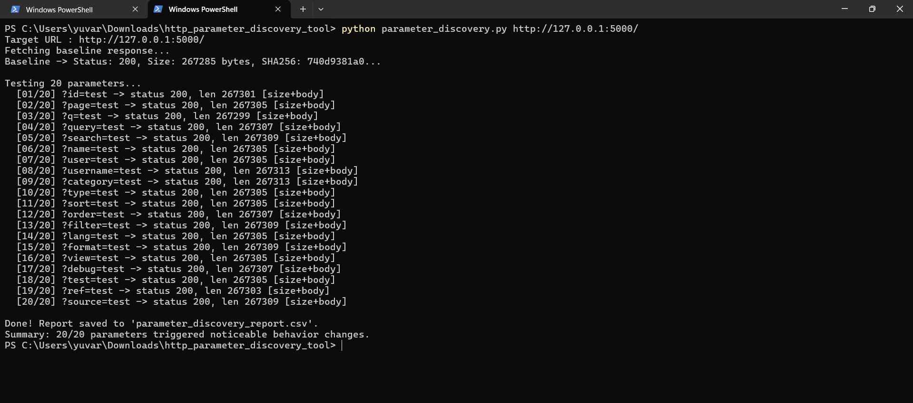
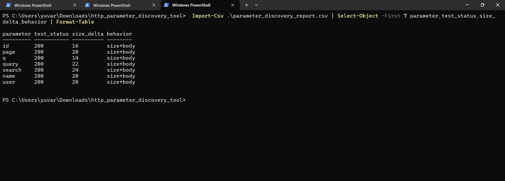

# HTTP Parameter Discovery Tool

[](https://www.python.org/) [](LICENSE) [](#scope--safety-policy) [](https://requests.readthedocs.io/)

A lightweight, automated HTTP parameter reconnaissance utility designed for local training applications and security audit labs.

The tool probes target endpoints using a predefined list of harmless parameter names, benchmarks candidate responses against an established baseline, and flags observable differences in HTTP status codes, byte sizes, and cryptographic SHA-256 body fingerprints.

---

## Table of Contents

- [Overview](#overview)
- [Key Features](#key-features)
- [Repository Structure](#repository-structure)
- [Visual Walkthrough & Screenshots](#visual-walkthrough--screenshots)
  - [1. Full Tool Execution (`01_tool_execution.png`)](#1-full-tool-execution-01_tool_executionpng)
  - [2. Report Inspection & Analysis (`02_report_inspection.png`)](#2-report-inspection--analysis-02_report_inspectionpng)
- [Installation & Prerequisites](#installation--prerequisites)
- [Usage Instructions](#usage-instructions)
  - [Basic Execution](#basic-execution)
  - [Custom Arguments & Flags](#custom-arguments--flags)
- [CSV Report Schema](#csv-report-schema)
- [Behavioral Classification](#behavioral-classification)
- [Scope & Safety Policy](#scope--safety-policy)
- [License](#license)

---

## Overview

Modern web applications frequently handle hidden, optional, or unlinked HTTP GET parameters that alter execution paths (e.g., triggering debugging views, rendering alternate data formats, or paginating datasets). 

This tool automates the process of discovering these parameters in a controlled lab environment. By executing differential HTTP analysis, it records whether adding an innocuous parameter (such as `debug=test` or `format=test`) causes the server to respond differently than it does to an unparameterized baseline request.

---

## Key Features

- **Strict Loopback Safety Lock:** Target validation ensures requests are only sent to `localhost`, `127.0.0.1`, or `::1`, preventing accidental scans against unauthorized external targets.
- **Harmless Dictionary Probing:** Evaluates 20 non-destructive, commonly encountered parameter keys using a safe static value (`test`).
- **Baseline Profiling:** Requests the unparameterized base URL first to establish initial response metrics (HTTP status code, body size in bytes, and content hash).
- **Multi-Vector Differential Analysis:**
  - **Status Change:** Detects changes in HTTP response code (e.g., `200 OK` vs `404 Not Found`).
  - **Size Delta:** Tracks exact byte changes (`test_size - baseline_size`).
  - **Body Fingerprint:** Uses cryptographic SHA-256 hashing to identify template variations or subtle string modifications even when response lengths match.
- **Structured CSV Export:** Writes all results to `parameter_discovery_report.csv` (or a custom path) for analysis in spreadsheets, data frames, or SIEM pipelines.
- **Traffic Throttling:** Includes configurable per-request timeouts and delays to avoid overwhelming local development servers.

---

## Repository Structure

```text
http_parameter_discovery_tool/
├── docs/
│   └── screenshots/                    # Demonstration screenshots for GitHub
│       ├── 01_tool_execution.png       # Complete tool execution terminal capture
│       └── 02_report_inspection.png    # Formatted CSV report analysis capture
├── reports/
│   └── parameter_discovery_report.csv  # Default export location for scan data
├── src/
│   └── parameter_discovery.py          # Core parameter discovery engine
├── .gitignore                          # Standard Python repository ignores
├── LICENSE                             # MIT License
├── parameter_discovery.py              # Root launcher entrypoint
├── README.md                           # Project documentation
└── requirements.txt                    # Project dependencies
```

---

## Visual Walkthrough & Screenshots

> **Note for Contributors / Users:**
> Capture the terminal and report views as outlined below and save them into the `docs/screenshots/` folder using the exact filenames specified so they automatically render on GitHub.

### 1. Full Tool Execution (`01_tool_execution.png`)

This screenshot demonstrates the full end-to-end execution of the discovery tool in a single terminal window:
- **Baseline Profiling:** Validates the target URL and establishes baseline response metrics (HTTP status code, content byte length, and SHA-256 fingerprint).
- **Automated Enumeration:** Sequentially queries the endpoint with candidate parameters, displaying real-time status codes, response lengths, and observed behavioral change tags (e.g., `[size+body]`, `[status+size+body]`).
- **Execution Summary:** Concludes with total parameters tested and the count of responses showing identifiable divergences.



*Figure 1: Complete execution lifecycle from baseline profiling to finished scan output.*

---

### 2. Report Inspection & Analysis (`02_report_inspection.png`)

This screenshot displays the structured discovery report generated by the tool (`parameter_discovery_report.csv`):
- Shows each parameter name along with its baseline vs test status, byte sizes, calculated byte delta (`size_delta`), SHA-256 checksums, and behavioral classification.
- Can be viewed via PowerShell (`Import-Csv`), Linux/macOS terminal tools (`column`, `cat`), or spreadsheet applications.



*Figure 2: Formatted inspection of the output CSV report showing differential findings.*

---

## Installation & Prerequisites

### Prerequisites
- Python 3.8 or higher
- PowerShell, Command Prompt, or Bash

### Installation

1. **Clone the repository:**
   ```bash
   git clone https://github.com/your-username/http_parameter_discovery_tool.git
   cd http_parameter_discovery_tool
   ```

2. **Install required dependencies:**
   ```bash
   python -m pip install -r requirements.txt
   ```

---

## Usage Instructions

### Basic Execution

Ensure your local training application is running (e.g., on port 5000), then execute:

```bash
python parameter_discovery.py http://127.0.0.1:5000/
```

Or run via the `src/` directory directly:

```bash
python src/parameter_discovery.py http://127.0.0.1:5000/
```

### Custom Arguments & Flags

You can customize the output destination, per-request network timeout, and inter-request delay:

```bash
# Save to reports folder with custom timeout and delay
python parameter_discovery.py http://127.0.0.1:5000/ -o reports/parameter_discovery_report.csv -t 3.0 -d 0.2
```

#### CLI Help Flag:
```bash
python parameter_discovery.py --help
```

```text
usage: parameter_discovery.py [-h] [-o OUTPUT] [-t TIMEOUT] [-d DELAY] url

Test local web applications for parameter response differences.

positional arguments:
  url                   Target URL (e.g. http://127.0.0.1:5000/ or http://localhost:8000/)

options:
  -h, --help            show this help message and exit
  -o OUTPUT, --output OUTPUT
                        Output CSV path (default: parameter_discovery_report.csv)
  -t TIMEOUT, --timeout TIMEOUT
                        Per-request timeout in seconds (default: 5.0)
  -d DELAY, --delay DELAY
                        Delay between requests in seconds (default: 0.1)
```

---

## CSV Report Schema

The output CSV file contains 12 structured fields detailing every parameter tested:

| Column | Data Type | Description |
| :--- | :--- | :--- |
| `parameter` | String | Parameter name tested (e.g. `debug`, `page`, `format`). |
| `test_value` | String | Static harmless test string (`test`). |
| `baseline_status` | Integer | HTTP status code returned during the baseline check (e.g. `200`). |
| `test_status` | Integer | HTTP status code returned when testing with the parameter. |
| `baseline_size` | Integer | Response body size in bytes for the baseline request. |
| `test_size` | Integer | Response body size in bytes for the candidate parameter request. |
| `size_delta` | Integer | Difference in bytes: `test_size - baseline_size`. |
| `baseline_sha256` | String | Complete SHA-256 hexadecimal hash of the baseline response body. |
| `test_sha256` | String | Complete SHA-256 hexadecimal hash of the candidate response body. |
| `behavior` | String | Classification tag(s) indicating what changed (`no_change`, `status`, `size`, `body`). |
| `url_tested` | String | Target URL provided to the tool. |
| `error` | String | Network error or timeout message if the request failed. |

---

## Behavioral Classification

The `behavior` column indicates the exact nature of the response difference:

- **`no_change`**: The parameter caused zero observable alteration in status, length, or body hash. The application likely ignores this parameter.
- **`status`**: The parameter caused the application to return a different HTTP status code (e.g., `200` &rarr; `404` or `400`).
- **`size`**: The response body byte length changed, indicating content was added or omitted.
- **`body`**: The byte length remained the same, but the SHA-256 checksum differed (e.g., dynamic strings or timestamps).
- **`status+size+body`** / **`size+body`**: Combinations showing multi-attribute divergence.
- **`request_error`**: Request timed out or encountered a connection reset.

---

## Scope & Safety Policy

This tool was designed strictly for lab training, authorized security testing, and educational reconnaissance exercises.

- **Loopback Enforcement:** By default, target inputs are restricted to loopback addresses (`127.0.0.1`, `localhost`, `::1`).
- **Non-Destructive Testing:** Probes use fixed, innocuous parameter values (`test`). It does not perform SQL injection, fuzzing, brute forcing, or authentication tampering.
- **Authorized Testing Only:** Only test applications that you own or have explicit written authorization to assess.

---

## License

This project is licensed under the MIT License. See the [LICENSE](LICENSE) file for details.
